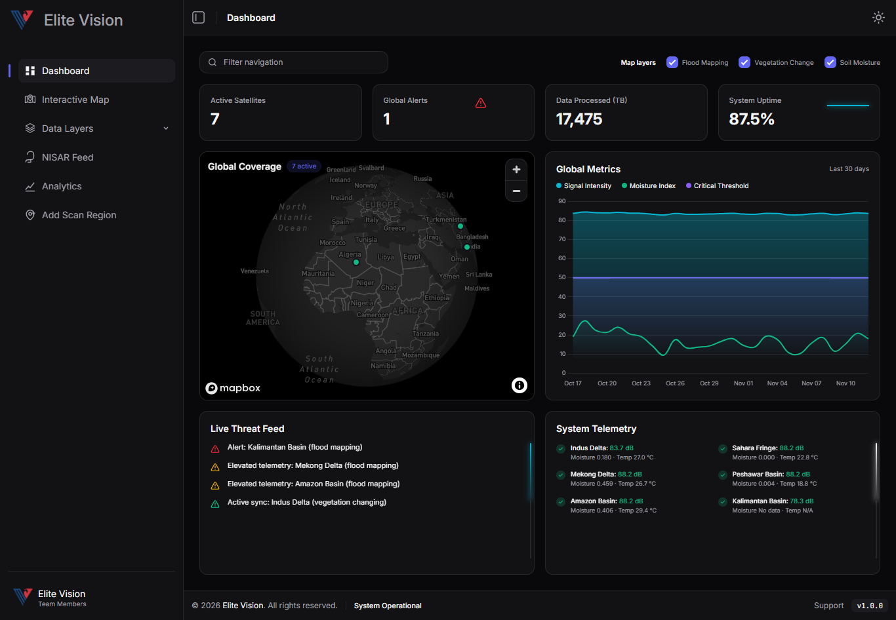
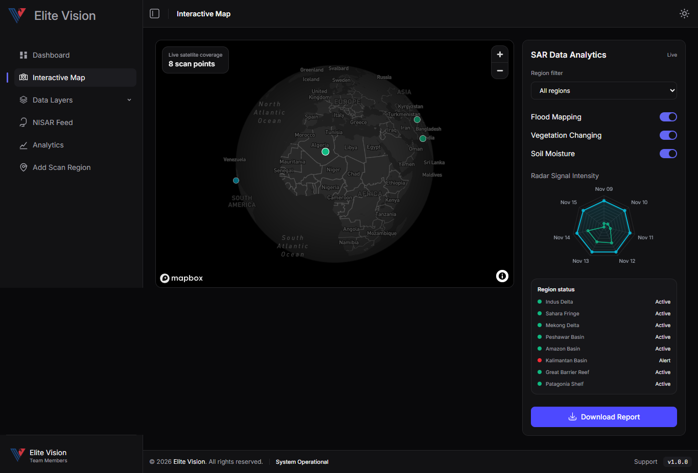
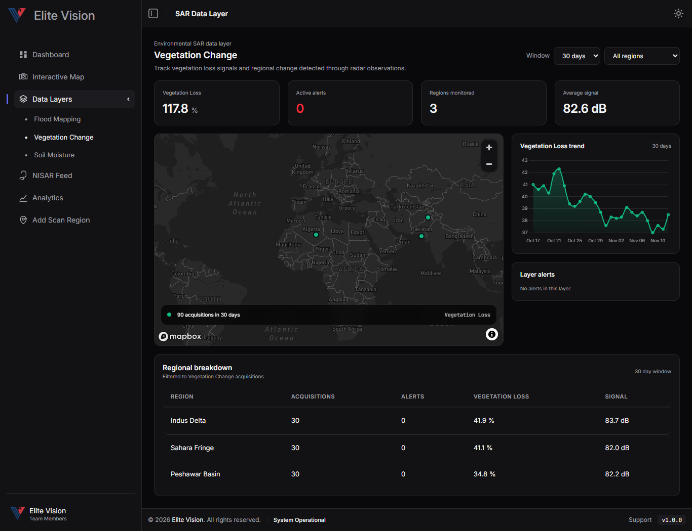
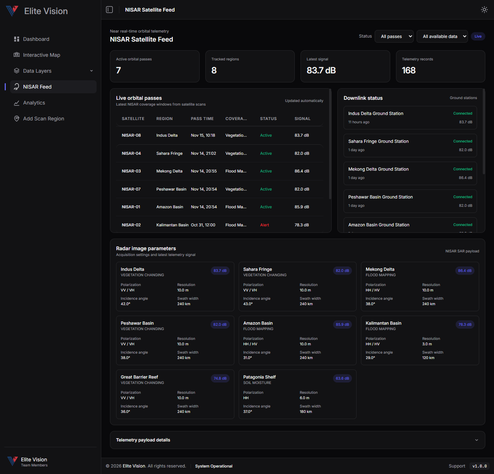
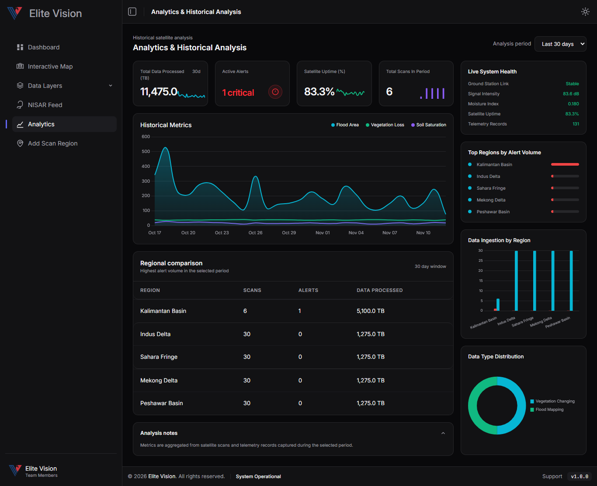

# Elite Vision — L-Band SAR & NASA POWER Environmental Intelligence Platform

**Elite Vision** is a real-time satellite telemetry and environmental monitoring platform built for the **NASA Space Apps Challenge**. It combines **NISAR L-Band Synthetic Aperture Radar (SAR)** mission parameters with live **NASA POWER API** meteorological and soil telemetry (`T2M`, `PRECTOTCORR`, `GWETTOP`, `RH2M`) to detect flood inundation, vegetation cover changes, and soil saturation across global regions.

# Elite Vision — L-Band SAR & NASA POWER Environmental Intelligence Platform

**Elite Vision** is a real-time satellite telemetry and environmental monitoring platform built for the **NASA Space Apps Challenge**. It combines **NISAR L-Band Synthetic Aperture Radar (SAR)** mission parameters with live **NASA POWER API** meteorological and soil telemetry (`T2M`, `PRECTOTCORR`, `GWETTOP`, `RH2M`) to detect flood inundation, vegetation cover changes, and soil saturation across global regions.

**Live Video Demo:** [Watch on YouTube (5-Minute Walkthrough)](https://youtu.be/5Fbz8SBzqU4)

## Platform Preview

## Platform Preview

### Executive Telemetry Dashboard


### Interactive Global SAR Map & Scan Point Telemetry


### SAR Data Layers & NISAR Orbital Feed
| Data Layers (`Flood`, `Vegetation`, `Soil`) | NISAR Satellite Feed & Downlink |
| :---: | :---: |
|  |  |

### Historical Analytics & Multi-Region Trends


## Key Capabilities
- **Executive Telemetry Dashboard:** Real-time KPIs (`Active Satellites`, `Global Alerts`, `Data Processed`, `System Uptime`), 3D Mapbox globe markers, live threat feed, and 30-day telemetry trend charts.
- **Interactive Global SAR Map:** Full-screen Mapbox GL visualization with scan-layer filtering and a live **Scan Point Details** inspection drawer.
- **Dedicated SAR Data Layers:** Specialized views for **Flood Mapping** (`HH / HV`), **Vegetation Change** (`VV / VH`), and **Soil Moisture** (`HH`) with regional breakdowns and historical curves.
- **NISAR Satellite Feed:** Live orbital pass schedules, ground station downlink health, and physics-informed radar payload parameters (polarization, resolution, incidence angle, swath width).
- **Analytics & Historical Analysis:** Multi-metric daily time-series analysis, alert volume rankings, and per-region acquisition volumes.
- **Live NASA POWER Ingestion (`Add Scan Region`):** Enter any latitude/longitude to fetch 30 days of real NASA POWER environmental data, auto-classify the dominant environmental layer, and persist telemetry across the entire platform.

## Tech Stack
- **Backend:** Laravel 13, PHP 8.3, Livewire 4, SQLite / MySQL
- **Frontend:** Tailwind CSS, Alpine.js, Mapbox GL JS, Chart.js, Vite
- **NASA Data Sources:** NASA POWER Daily API (`T2M`, `PRECTOTCORR`, `GWETTOP`, `RH2M`) & NISAR L-Band SAR Mission Specifications

## Local Installation
```bash
git clone https://github.com/irfan-ullahh/nasa-app-challange.git
cd nasa-app-challange
composer install && npm install
cp .env.example .env && php artisan key:generate
# Add your MAPBOX_TOKEN in .env
php artisan migrate --seed
npm run build && php artisan serve
